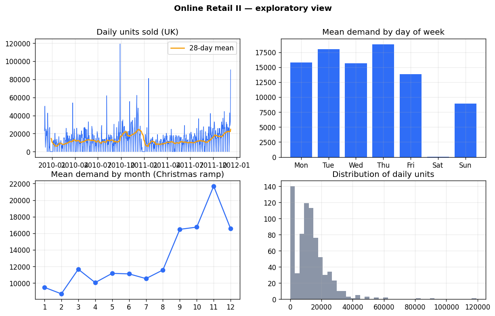
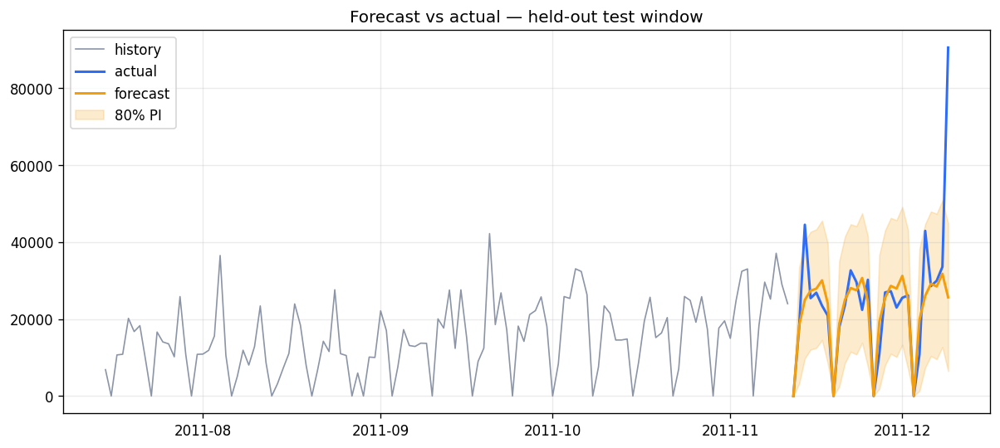
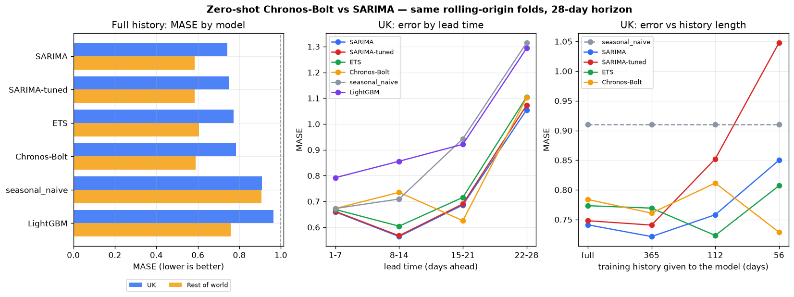

# demand-forecasting

> Daily demand forecasting on a public retail dataset, evaluated the way a
> production team would: a seasonal-naive baseline, three models of increasing
> sophistication, and a rolling-origin backtest that reports the lift over the
> baseline. Plus a small causal bonus that recovers a known promo uplift, and a
> zero-shot pretrained forecaster scored on the same backtest.


## TL;DR

**SARIMA reaches MASE 0.74 on a 6-fold rolling-origin backtest (28-day horizon) —
18.5% lower error than a seasonal-naive baseline, and lower on every metric
(sMAPE 29.7 vs 37.7, RMSE −14%).** A LightGBM with lag/calendar features is
included and, honestly, does *not* beat the classical seasonal models on this
single rigid-weekly series — a finding worth stating rather than hiding. A
two-way fixed-effects difference-in-differences recovers a known +15% promo
uplift as **14.9% (95% CI [14.2%, 15.6%])**.

```text
model            sMAPE     RMSE    MASE   MASE vs naive
SARIMA           29.67   6981.8   0.741        +18.5%
ETS              30.63   7174.3   0.773        +15.0%
seasonal_naive   37.73   8104.9   0.910          0.0%
LightGBM         36.77   8501.9   0.966         −6.1%
```


## Data

[UCI Online Retail II](https://archive.ics.uci.edu/dataset/502/online+retail+ii):
~1M transaction lines from a UK-based online gift retailer, Dec 2009 – Dec 2011.
Public, **no Kaggle authentication** — the download script pulls it straight from
UCI so the project reproduces from a single command. Raw data is **not** committed
(`data/` is gitignored); `python run.py` downloads and caches it locally.

Transactions are cleaned (cancellations and non-positive quantities dropped),
restricted to the United Kingdom (the dominant market), and aggregated to a
continuous **daily total-units** series of 739 days.

## What the EDA shows



- **Hard weekly seasonality.** Saturday is a structural zero — the retailer does
  not process orders that day. The model treats "store closed on Saturday" as a
  business rule and forces those forecasts to zero; the seasonal-naive baseline
  inherits the same zero from the prior week, so the comparison stays fair.
- **A Christmas ramp** into November/December, the retailer's peak.
- **Heavy-tailed daily volume** driven by occasional large wholesale orders, which
  is what makes the daily series genuinely hard (daily CV 0.86 vs weekly 0.44).

## Approach

```
data ─▶ EDA ─▶ baseline (seasonal-naive) ─▶ models ─▶ rolling-origin backtest ─▶ report
                                              │
                              ETS · SARIMA · LightGBM(lags+calendar)
```

1. **Baseline.** Seasonal-naive (m = 7) and a moving average. Everything must beat this.
2. **Classical.** Holt-Winters ETS and SARIMA(1,1,1)(1,1,1)₇.
3. **ML.** LightGBM on engineered features — lags (1,2,3,7,14,21,28), rolling
   mean/std/min/max (7,14,28), and calendar/holiday features — forecast
   recursively, with quantile models for prediction intervals. All lag and
   rolling features are shifted ≥1 day, so a row dated *t* never sees *t* or later.
4. **Evaluation.** Time-based **rolling-origin cross-validation**: 6 consecutive
   28-day test windows, each model trained only on its past. No shuffling, no
   leakage. Metrics: MASE (headline, scaled by the in-sample seasonal-naive
   error), sMAPE, RMSE.
5. **Prediction intervals + error analysis** on the most recent fold.
6. **Causal bonus.** Simulate a known +15% promo on treated stores in a synthetic
   panel and recover it with a two-way fixed-effects DiD.

## Forecast and error analysis



The 80% prediction interval comes from the SARIMA state-space model. Residuals are
roughly centered across the test window; the largest misses are the unpredictable
wholesale spikes, not the weekly structure.


## Causal bonus — recovering a promo uplift

There is no labelled promotion in the data, so we *simulate* one and check the
estimator against ground truth. A synthetic 24-store × 180-day panel is built from
the real demand *shape* (shared seasonality, store-level scaling, noise); a known
**+15%** uplift is applied to treated stores in the post period. A two-way
fixed-effects DiD on log demand — store FE absorbing level, date FE absorbing the
common seasonal movement — recovers **14.9% (95% CI [14.2%, 15.6%], p ≈ 0)**.

## Pretrained forecaster vs SARIMA

**Question:** does a zero-shot pretrained time-series model beat SARIMA under the
same rolling-origin backtest, and under what conditions?

`run_pretrained.py` adds [Chronos-Bolt](https://huggingface.co/amazon/chronos-bolt-small)
(`amazon/chronos-bolt-small`, CPU) to the backtest above with no other changes: the
same 6 folds, 28-day horizon, MASE scaling, closed-Saturday rule, seasonal-naive
baseline and SARIMA(1,1,1)(1,1,1)₇. The model is used zero-shot: pretrained weights,
no fine-tuning, and each fold passes only that fold's training history as context.
Its point forecast is the median quantile.

To make the answer decision-relevant, the script also reports:

- a second series (all non-UK countries combined: smaller and noisier),
- an AIC-tuned SARIMA that re-selects (p,q)(P,Q) on each fold's training data,
- fold-by-fold wins against SARIMA,
- MASE by lead time (days 1–7, 8–14, 15–21, 22–28), and
- MASE when every model sees only the last 365, 112 or 56 days of history.

Results, with the exact model commit and library versions, are written by the
script to [`docs/pretrained_results.md`](docs/pretrained_results.md) and
[`docs/pretrained_vs_sarima.png`](docs/pretrained_vs_sarima.png).
The write-up is
[Pretrained forecasters vs SARIMA](https://github.com/wavde/wavde/blob/main/writing/pretrained-forecasters-vs-sarima.md).

**Result: zero-shot Chronos-Bolt does not beat SARIMA with full history.**

```text
                  UK MASE   rest-of-world MASE
SARIMA              0.741          0.584
SARIMA-tuned        0.748          0.584
Chronos-Bolt        0.784          0.589
seasonal_naive      0.910          0.907
```

Both clearly beat seasonal-naive. Against SARIMA, Chronos-Bolt wins 1 of 6 UK folds
and 3 of 6 rest-of-world folds; most of the UK gap is one fold, the Christmas peak
(MASE 1.30 vs 1.04). Per-fold AIC tuning barely moves SARIMA. Chronos-Bolt does beat
both SARIMAs when models only get a short history: with the last 56 days, 0.729 vs
0.850 fixed / 1.048 tuned (UK) and 0.600 vs 0.737 / 0.702 (rest of world). With
that little data, AIC tuning overfits on the UK series. Six folds per series can't
separate differences of a few percent.



**Determinism.** Chronos-Bolt predicts quantiles in a single forward pass with no
sampling (unlike the original Chronos, which samples trajectories). The script
also fixes the seed (`SEED = 7`) and runs torch on CPU with one thread, so reruns
on the same machine and library versions match.

## Reproduce

```bash
python -m venv .venv && source .venv/bin/activate   # Windows: .venv\Scripts\activate
pip install -r requirements.txt
python run.py        # downloads data, backtests, writes docs/*.png and reports/*
```

Everything is deterministic (`SEED = 7`), developed on **Python 3.12** and tested
on 3.10–3.12. Outputs land in `docs/` (figures) and `reports/` (`metrics.json`,
`metrics.md`).

The pretrained comparison needs an optional extra (torch + chronos-forecasting),
which the base install and CI do not use:

```bash
pip install -r requirements-pretrained.txt
python run_pretrained.py   # writes docs/pretrained_results.md, docs/pretrained_vs_sarima.png
```

The first run downloads the model weights (~190 MB) from Hugging Face, pinned to a
fixed commit in `pretrained.py`. The full comparison takes about 8 minutes on a laptop CPU, most of it the SARIMA order search.

```bash
pytest -q        # 44 tests: metrics, feature leakage, baselines, backtest, DiD, data, models, pretrained wrapper
ruff check .     # lint
```

## Repo layout

```
src/demand_forecasting/
  config.py       paths, seed, horizon, the closed-Saturday business rule
  data.py         download + clean + aggregate to a daily series
  metrics.py      MAPE / sMAPE / RMSE / MASE
  features.py     leakage-safe lag, rolling, calendar/holiday features
  baselines.py    naive, seasonal-naive, moving average
  models.py       ETS, SARIMA (fixed and AIC-tuned), LightGBM (recursive, with intervals)
  pretrained.py   zero-shot Chronos-Bolt wrapper (optional extra)
  backtest.py     rolling-origin CV, per-step forecasts, lead-time and fold summaries
  postprocess.py  closed-day business rule
  causal.py       synthetic promo panel + two-way FE DiD
  plots.py        EDA and diagnostic figures
run.py            single-command end-to-end pipeline
run_pretrained.py single-command pretrained-vs-SARIMA comparison
tests/            unit tests for the pure functions
```

## What I'd do next

- **Where ML should win:** move from one aggregate series to a *global* model
  across many SKUs/stores. A single rigid-weekly aggregate is exactly the regime
  where classical seasonal models are hard to beat; cross-series learning and
  hierarchical reconciliation are where gradient boosting and global neural
  forecasters earn their keep.
- **Probabilistic evaluation:** score the prediction intervals directly
  (pinball loss, empirical coverage), not just the point forecast.
- **Exogenous drivers:** promotions, price, and weather as features, which also
  makes the causal and forecasting tracks share one feature store.

## License

MIT. All data is public (UCI) and downloaded at runtime; none is committed.
