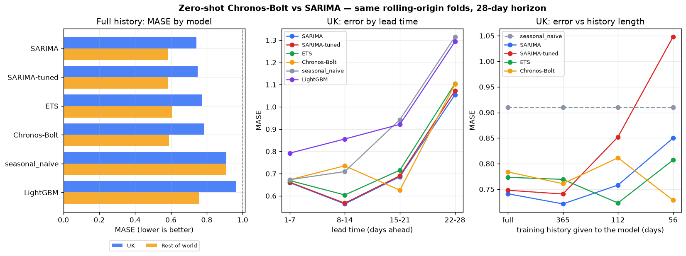

# Zero-shot pretrained forecaster vs SARIMA

_Generated by `python run_pretrained.py`; do not edit by hand. Python 3.12.10, seed 7, model `amazon/chronos-bolt-small` (commit `772f3d25d38aec6d914c8949dab4462e2d46f5d8`), chronos-forecasting 2.3.2, torch 2.15.0, transformers 5.24.1._

## Setup

- **Same backtest as the main pipeline.** 6 rolling-origin folds, 28-day horizon, expanding training window, identical folds for every model. Saturday forecasts are forced to zero for every model (the retailer does not trade on Saturdays).
- **Metric.** MASE, scaled by each fold's in-sample seasonal-naive (m = 7) error, averaged across folds. sMAPE and RMSE are reported alongside.
- **Baselines.** Seasonal-naive (m = 7); SARIMA(1,1,1)(1,1,1)7, the same fixed specification as the main backtest; and `SARIMA-tuned`, which re-selects (p,q)(P,Q) in {0,1,2}x{0,1,2}x{0,1}x{0,1} by AIC on each fold's training data (d = D = 1, so AIC is comparable). ETS and LightGBM are included for continuity with the main results.
- **Pretrained model.** `amazon/chronos-bolt-small`, zero-shot: pretrained weights, no fine-tuning, only the fold's training history as context. Point forecast is the 0.5 quantile (the optimal point forecast under absolute error).
- **Determinism.** Chronos-Bolt predicts quantiles in one forward pass with no sampling. The run uses CPU, one torch thread and a fixed seed.
- **Series.** `UK` is the daily-units series from the main backtest. `Rest of world` is every other country combined: smaller and noisier.

## Headline

- **UK:** Chronos-Bolt MASE **0.784** vs SARIMA **0.741** (5.8% higher); Chronos-Bolt has the lower MASE in **1 of 6 folds**. Median per-fold difference +0.011; largest +0.260 (fold 5, 2011-11-12 to 2011-12-09). AIC-tuned SARIMA: **0.748** (Chronos-Bolt lower in 2 of 6 folds). Seasonal-naive: 0.910.
- **Rest of world:** Chronos-Bolt MASE **0.589** vs SARIMA **0.584** (0.8% higher); Chronos-Bolt has the lower MASE in **3 of 6 folds**. Median per-fold difference +0.006; largest +0.045 (fold 5, 2011-11-12 to 2011-12-09). AIC-tuned SARIMA: **0.584** (Chronos-Bolt lower in 3 of 6 folds). Seasonal-naive: 0.907.

## Full-history backtest (mean across folds)

### UK

| model | sMAPE | RMSE | MASE | MASE vs seasonal-naive |
|---|---|---|---|---|
| SARIMA | 29.67 | 6981.8 | 0.741 | +18.5% |
| SARIMA-tuned | 29.87 | 7064.1 | 0.748 | +17.8% |
| ETS | 30.63 | 7174.3 | 0.773 | +15.0% |
| Chronos-Bolt | 30.82 | 7411.3 | 0.784 | +13.9% |
| seasonal_naive | 37.73 | 8104.9 | 0.910 | +0.0% |
| LightGBM | 36.77 | 8501.9 | 0.966 | -6.1% |

### Rest of world

| model | sMAPE | RMSE | MASE | MASE vs seasonal-naive |
|---|---|---|---|---|
| SARIMA | 72.64 | 3259.7 | 0.584 | +35.6% |
| SARIMA-tuned | 72.98 | 3272.9 | 0.584 | +35.6% |
| Chronos-Bolt | 77.47 | 3452.4 | 0.589 | +35.1% |
| ETS | 74.49 | 3332.3 | 0.605 | +33.3% |
| LightGBM | 91.15 | 3902.8 | 0.758 | +16.5% |
| seasonal_naive | 100.61 | 4713.1 | 0.907 | +0.0% |

## Fold by fold: Chronos-Bolt vs SARIMA (MASE)

`best SARIMA` is the lower of the two SARIMAs in that fold, chosen after seeing the test error, so it is deliberately generous to SARIMA.

| series | fold | test window | SARIMA | SARIMA-tuned | Chronos-Bolt | Chronos-Bolt minus best SARIMA |
|---|---|---|---|---|---|---|
| UK | 0 | 2011-06-25 to 2011-07-22 | 0.413 | 0.411 | 0.425 | +0.015 |
| UK | 1 | 2011-07-23 to 2011-08-19 | 0.628 | 0.619 | 0.640 | +0.020 |
| UK | 2 | 2011-08-20 to 2011-09-16 | 0.752 | 0.750 | 0.759 | +0.009 |
| UK | 3 | 2011-09-17 to 2011-10-14 | 0.826 | 0.832 | 0.780 | -0.046 |
| UK | 4 | 2011-10-15 to 2011-11-11 | 0.788 | 0.845 | 0.798 | +0.010 |
| UK | 5 | 2011-11-12 to 2011-12-09 | 1.041 | 1.031 | 1.301 | +0.270 |
| Rest of world | 0 | 2011-06-25 to 2011-07-22 | 0.457 | 0.454 | 0.418 | -0.036 |
| Rest of world | 1 | 2011-07-23 to 2011-08-19 | 0.705 | 0.710 | 0.720 | +0.015 |
| Rest of world | 2 | 2011-08-20 to 2011-09-16 | 0.466 | 0.464 | 0.450 | -0.014 |
| Rest of world | 3 | 2011-09-17 to 2011-10-14 | 0.611 | 0.621 | 0.638 | +0.027 |
| Rest of world | 4 | 2011-10-15 to 2011-11-11 | 0.780 | 0.780 | 0.777 | -0.003 |
| Rest of world | 5 | 2011-11-12 to 2011-12-09 | 0.485 | 0.475 | 0.530 | +0.055 |

With 6 folds per series, a win count is descriptive, not a significance test.

## SARIMA orders chosen by AIC (full history)

| series | train ends | train days | (p,d,q) | (P,D,Q)7 | AIC |
|---|---|---|---|---|---|
| UK | 2011-06-24 | 571 | (2, 1, 2) | (1, 1, 1) | 11697.0 |
| UK | 2011-07-22 | 599 | (2, 1, 2) | (0, 1, 1) | 12262.7 |
| UK | 2011-08-19 | 627 | (2, 1, 2) | (1, 1, 1) | 12835.8 |
| UK | 2011-09-16 | 655 | (2, 1, 2) | (0, 1, 1) | 13414.7 |
| UK | 2011-10-14 | 683 | (0, 1, 1) | (0, 1, 1) | 13938.2 |
| UK | 2011-11-11 | 711 | (1, 1, 2) | (1, 1, 1) | 14568.1 |
| Rest of world | 2011-06-24 | 571 | (2, 1, 2) | (0, 1, 1) | 11521.8 |
| Rest of world | 2011-07-22 | 599 | (2, 1, 2) | (0, 1, 1) | 12079.6 |
| Rest of world | 2011-08-19 | 627 | (2, 1, 2) | (0, 1, 1) | 12640.7 |
| Rest of world | 2011-09-16 | 655 | (2, 1, 2) | (0, 1, 1) | 13196.7 |
| Rest of world | 2011-10-14 | 683 | (2, 1, 2) | (0, 1, 1) | 13755.7 |
| Rest of world | 2011-11-11 | 711 | (2, 1, 2) | (0, 1, 1) | 14321.9 |

## MASE by lead time (full history)

### UK

| model | days 1-7 | days 8-14 | days 15-21 | days 22-28 |
|---|---|---|---|---|
| SARIMA | 0.660 | 0.564 | 0.686 | 1.055 |
| SARIMA-tuned | 0.661 | 0.567 | 0.690 | 1.073 |
| ETS | 0.669 | 0.604 | 0.716 | 1.104 |
| Chronos-Bolt | 0.673 | 0.735 | 0.626 | 1.102 |
| seasonal_naive | 0.673 | 0.709 | 0.943 | 1.315 |
| LightGBM | 0.792 | 0.856 | 0.921 | 1.293 |

### Rest of world

| model | days 1-7 | days 8-14 | days 15-21 | days 22-28 |
|---|---|---|---|---|
| SARIMA | 0.683 | 0.481 | 0.549 | 0.622 |
| SARIMA-tuned | 0.697 | 0.475 | 0.546 | 0.618 |
| Chronos-Bolt | 0.750 | 0.463 | 0.538 | 0.603 |
| ETS | 0.724 | 0.497 | 0.565 | 0.634 |
| LightGBM | 0.745 | 0.616 | 0.854 | 0.815 |
| seasonal_naive | 1.073 | 0.726 | 0.883 | 0.946 |

## MASE when models see only the last N days of history

Same folds and test windows; only the context given to each model is truncated. MASE is still scaled by the full training split, so rows are comparable. Seasonal-naive only uses the last 7 days, so it does not change.

### UK

| history (days) | seasonal_naive | SARIMA | SARIMA-tuned | ETS | Chronos-Bolt |
|---|---|---|---|---|---|
| full | 0.910 | 0.741 | 0.748 | 0.773 | 0.784 |
| 365 | 0.910 | 0.721 | 0.741 | 0.769 | 0.761 |
| 112 | 0.910 | 0.758 | 0.852 | 0.723 | 0.811 |
| 56 | 0.910 | 0.850 | 1.048 | 0.807 | 0.729 |

### Rest of world

| history (days) | seasonal_naive | SARIMA | SARIMA-tuned | ETS | Chronos-Bolt |
|---|---|---|---|---|---|
| full | 0.907 | 0.584 | 0.584 | 0.605 | 0.589 |
| 365 | 0.907 | 0.612 | 0.601 | 0.615 | 0.594 |
| 112 | 0.907 | 0.678 | 0.650 | 0.660 | 0.589 |
| 56 | 0.907 | 0.737 | 0.702 | 0.729 | 0.600 |

## Where Chronos-Bolt beats both SARIMAs in this backtest

- UK, full history, days 15-21 ahead: Chronos-Bolt 0.626 vs SARIMA 0.686, SARIMA-tuned 0.690
- UK, last 56 days of history, all lead times: Chronos-Bolt 0.729 vs SARIMA 0.850, SARIMA-tuned 1.048
- Rest of world, full history, days 8-14 ahead: Chronos-Bolt 0.463 vs SARIMA 0.481, SARIMA-tuned 0.475
- Rest of world, full history, days 15-21 ahead: Chronos-Bolt 0.538 vs SARIMA 0.549, SARIMA-tuned 0.546
- Rest of world, full history, days 22-28 ahead: Chronos-Bolt 0.603 vs SARIMA 0.622, SARIMA-tuned 0.618
- Rest of world, last 365 days of history, all lead times: Chronos-Bolt 0.594 vs SARIMA 0.612, SARIMA-tuned 0.601
- Rest of world, last 112 days of history, all lead times: Chronos-Bolt 0.589 vs SARIMA 0.678, SARIMA-tuned 0.650
- Rest of world, last 56 days of history, all lead times: Chronos-Bolt 0.600 vs SARIMA 0.737, SARIMA-tuned 0.702

## Where it does not (either SARIMA lower or equal)

- UK, full history, all lead times: Chronos-Bolt 0.784 vs SARIMA 0.741, SARIMA-tuned 0.748
- UK, full history, days 1-7 ahead: Chronos-Bolt 0.673 vs SARIMA 0.660, SARIMA-tuned 0.661
- UK, full history, days 8-14 ahead: Chronos-Bolt 0.735 vs SARIMA 0.564, SARIMA-tuned 0.567
- UK, full history, days 22-28 ahead: Chronos-Bolt 1.102 vs SARIMA 1.055, SARIMA-tuned 1.073
- UK, last 365 days of history, all lead times: Chronos-Bolt 0.761 vs SARIMA 0.721, SARIMA-tuned 0.741
- UK, last 112 days of history, all lead times: Chronos-Bolt 0.811 vs SARIMA 0.758, SARIMA-tuned 0.852
- Rest of world, full history, all lead times: Chronos-Bolt 0.589 vs SARIMA 0.584, SARIMA-tuned 0.584
- Rest of world, full history, days 1-7 ahead: Chronos-Bolt 0.750 vs SARIMA 0.683, SARIMA-tuned 0.697

## Limitations

- One retailer, two daily series, six 28-day test windows each. Differences of a few percent in MASE are within fold-to-fold noise.
- SARIMA tuning is a small AIC grid with fixed differencing, not a full auto-ARIMA search. A wider search could move SARIMA in either direction.
- The model's public pretraining corpus is not audited here for overlap with UCI Online Retail II. Overlap would flatter the pretrained model.
- Point forecasts only. The quantile forecasts are not scored for coverage.
- CPU float results can differ in the last digits across machines or library versions; the versions used are recorded above.

